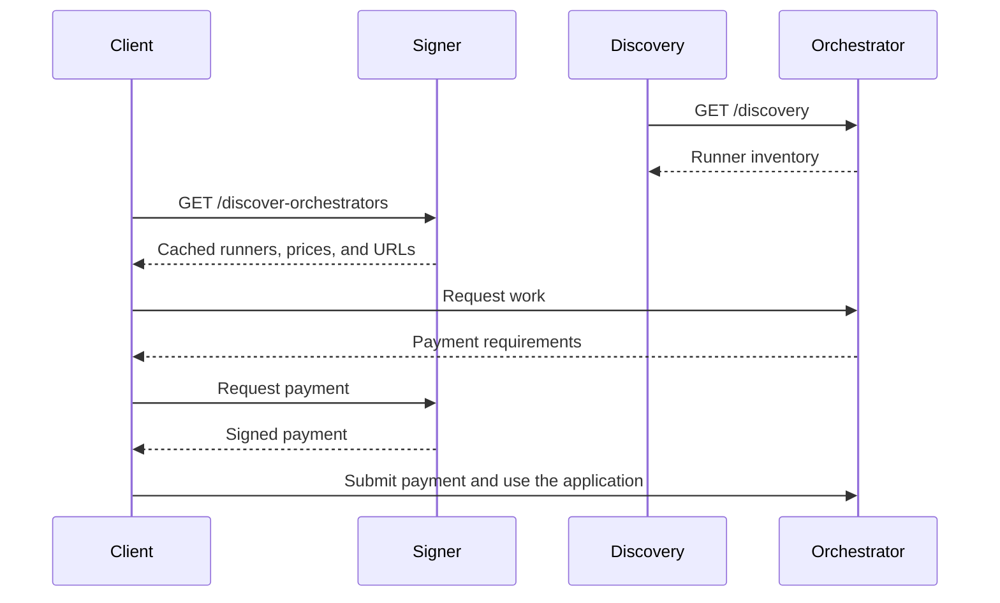

# Signer and discovery with a static orchestrator list

Run `livepeer-discovery` (or `livepeer discovery`) against a fixed list of
orchestrator base URLs, and point `livepeer-signer` at that one discovery
process. The list is an operator choice. It is not read from the chain, and
it is not a payment control.

Discovery collects runner inventories. The signer authorizes and signs
payments. Clients talk to orchestrators directly. Neither process needs a
local runner.



Install the binaries from [installation](../README.md#install). Field names,
grants, and secret files are in [configuration](configuration.md). The
inventory shape is in [discovery HTTP](http-api.md#discovery-http).

## What each process owns

| Process | Owns | Does not own |
| --- | --- | --- |
| Discovery | The static `Nodes` list, the cache, `GET /discovery` | Keys, TicketBroker funds, price ceilings |
| Signer | The payer key, price limits, `GET /discover-orchestrators` | The orchestrator list, runner processes |

Put every orchestrator on discovery. Give the signer a single
`Orchestrators` entry: the discovery base URL. Listing the same orchestrators
on both processes makes the signer poll them itself and ignores the cache you
just stood up.

## Prerequisites

- Orchestrator base URLs that answer `GET /discovery`. A base URL is an
  HTTP(S) origin plus any deployment path, with no query and no fragment
  ([RFC 3986](https://www.rfc-editor.org/rfc/rfc3986)). Discovery requests
  `<base>/discovery`.
- HTTPS orchestrators whose certificates chain to the system trust store.
  A self-signed certificate fails that probe and stays out of the cache.
- A signer account with a TicketBroker deposit and reserve. Create the
  keystore and fund it with the [chain CLI](chain.md) before expecting
  payments to succeed. Discovery does not wait on that account.
- Loopback is enough for this sample. Both listeners default to `127.0.0.1`.
  A non-loopback bind needs the `unsafe@` prefix described in
  [configuration](configuration.md#local-storage-and-probes). Put TLS on a
  proxy in front of either listener; the processes themselves speak HTTP.

Public orchestrators need no `Grants`. A loopback or private address is
refused until its IP, `IP:port`, or CIDR is granted for that purpose.
`192.168.1.10:8935` allows that socket. `192.168.1.0/24` allows any port on
that network. Grants are checked against each resolved address at connect
time.

## Write the discovery config

Copy [configs/discovery/config.example.toml](../configs/discovery/config.example.toml)
to `/etc/livepeer/discovery.toml`. Replace the example node with the
orchestrators you intend to pay:

```toml
Listen = "127.0.0.1:8939"
MetricsListen = "127.0.0.1:8940"

# Base URLs only. Discovery appends /discovery.
# Keep this list acyclic: orchestrators, not another discovery process
# that lists this one.
Nodes = [
  "https://orch-a.example:8935",
  "https://orch-b.example:8935",
]

AdvertiseNodes = true
AdvertiseRunners = true
RefreshInterval = "5m"
MaxFailedRefreshes = 6
```

`Nodes` is the static list. Duplicate URLs are skipped. Add `Grants` only
when a URL resolves to a local or private address:

```toml
Nodes = ["http://127.0.0.1:8935"]
Grants = ["127.0.0.1:8935"]
```

`AdvertiseNodes` and `AdvertiseRunners` both default to true. Turning either
off drops the metadata entry or the runner entries. Turning both off returns
`[]` and stops collection.

## Start discovery

```sh
livepeer discovery --config /etc/livepeer/discovery.toml
```

`livepeer-discovery` takes the same flags. The default data directory is
`~/.lpData/offchain/discovery`. The cache is memory only; a restart is empty
until the next successful probe.

Check the metrics listener, then the inventory. The first probe runs at
startup. Each request has a three-second timeout, responses are capped at
1 MiB, and at most five sources are fetched at once.

```sh
curl -fsS http://127.0.0.1:8940/readyz
curl -fsS http://127.0.0.1:8939/discovery
```

Readiness means the process is up. It stays ready when every source is down.
`GET /discovery` then returns whatever is still cached, or `[]` before the
first success.

To print one combined inventory and exit, without listeners or a refresh
loop:

```sh
livepeer discovery --config /etc/livepeer/discovery.toml --dump
```

`--dump` writes a newline-terminated JSON array to stdout and diagnostics to
stderr. Exit 0 covers an empty or partial success. Exit 2 means the run
failed; partial JSON may already have been written. Do not combine `--dump`
with `--print-config`.

A successful document looks like this. `observed_at` and `queried_at` are
[RFC 3339](https://www.rfc-editor.org/rfc/rfc3339) timestamps. The leading
object is metadata: discovery has no public address of its own.

```json
[
  {"nodes": [
    {"url": "https://orch-a.example:8935", "queried_at": "2026-11-09T18:00:00Z"}
  ]},
  {"address": "https://orch-a.example:8935", "runners": [
    {
      "url": "https://orch-a.example:8935/apps/example/app",
      "app": "example",
      "observed_at": "2026-11-09T18:00:00Z"
    }
  ]}
]
```

`address` here is the orchestrator HTTP(S) base URL, not an Ethereum account.

## Point the signer at discovery

Copy [configs/signer/config.example.toml](../configs/signer/config.example.toml)
to `/etc/livepeer/signer.toml`. The signer still needs a keystore, a password
file, an RPC URL file, and price limits. Those files are exact bytes and
owner-only (`0400` or `0600`); see
[credential files](configuration.md#credential-files).

The discovery block is only the local discovery listener:

```toml
Listen = "127.0.0.1:8937"
MetricsListen = "127.0.0.1:8938"

KeystorePasswordFile = "/run/secrets/livepeer-signer-keystore-password"
RPCURLFile = "/run/secrets/livepeer-signer-rpc-url"

# One source: the discovery process above. The signer appends /discovery.
Orchestrators = ["http://127.0.0.1:8939"]
DiscoveryGrants = ["127.0.0.1:8939"]
DiscoveryRefreshInterval = "5m"
DiscoveryMaxFailedRefreshes = 6

MaxHourlyPrice = "36"
MaxFixedPrice = "1"
```

`DiscoveryGrants` is required because `127.0.0.1` is loopback. A discovery
service on a public name would not need a grant. Do not set
`OrchestratorWebhookFile` in this sample; a webhook replaces `Orchestrators`.

Price limits are in USD. `MaxHourlyPrice` caps work billed by duration.
`MaxFixedPrice` caps work billed per request. The static list does not raise
or lower them. An orchestrator you listed is still refused at signing time
when its price is above the ceiling.

## Start the signer and query it

```sh
livepeer signer --config /etc/livepeer/signer.toml
```

```sh
curl -fsS http://127.0.0.1:8938/readyz
curl -fsS 'http://127.0.0.1:8937/discover-orchestrators?app=example'
```

Omit `app`, or add `gpu=H100`, to widen or narrow the same cache. Filters are
exact. Discovery itself does not filter and does not reserve capacity.

The signer polls discovery at startup and every `DiscoveryRefreshInterval`.
Each fetch times out at five seconds and rejects a body over 1 MiB. A failed
poll keeps the last inventory until `DiscoveryMaxFailedRefreshes` consecutive
failures, then drops it. `0` drops it on the first failure. A later success
puts that source back.

`GET /discover-orchestrators` returns 200 when at least one cached inventory
is usable, including a body of `[]` when nothing matches the filter. It
returns 503 when the signer has no usable cache, which is the state before
discovery's first successful probe.

Keep the signer listener on a private network or behind a proxy that
authenticates callers. Signed payment state is a bearer credential.

## When the list changes

Edit `Nodes` and restart discovery. There is no reload flag. An orchestrator
you remove disappears after that process starts again; the signer's copy
follows on its next poll, or sooner if you restart the signer too.

A source that starts failing is kept for `MaxFailedRefreshes` intervals
(default six failures, so about 30 minutes at the default `5m` interval) and
then evicted. Polling continues after eviction. An empty but successful
`GET /discovery` from an orchestrator replaces that source's runners
immediately. That is a healthy orchestrator with nothing to advertise, not a
network error.

Do not add this discovery URL to another discovery `Nodes` list that this
process also queries. Peer queries succeed, and a preserved `observed_at` has
no age limit, so a withdrawn runner can circulate between the two caches.

## Design choices

- **The list lives on discovery.** One file is the operator's allow-list.
  The signer stays a signer. Clients that already call
  `GET /discover-orchestrators` do not change.
- **The list is not on-chain state.** Bonded orchestrators that are absent
  from `Nodes` are invisible. Orchestrators on the list are probed even when
  they are unbonded. Membership is whoever you wrote down.
- **System trust, no pinned certificates.** Public HTTPS uses the platform
  trust store. Self-signed orchestrators drop out at probe time. Pinning
  belongs in the trust store or in a private CA, not in this config.
- **Grants are per process.** Discovery's `Grants` cover its probes. The
  signer's `DiscoveryGrants` cover its single hop to discovery. A grant does
  not authorize the URLs inside the inventory; clients connect to those
  themselves.
- **Caches are not durable.** Both processes rebuild from the network.
  Discovery can serve a partial inventory. The signer can serve a stale one
  until its failure limit.
- **Two failure clocks.** Discovery evicts an orchestrator after
  `MaxFailedRefreshes`. The signer evicts discovery after
  `DiscoveryMaxFailedRefreshes`. They do not share a counter.

## Operator tasks

1. Install `livepeer`, `livepeer-discovery`, and `livepeer-signer` from the
   same release, and confirm `livepeer version`.
2. Write `/etc/livepeer/discovery.toml` with the orchestrator base URLs.
   Add `Grants` only for private or loopback sources.
3. Start discovery. Confirm `/readyz` on port 8940 and a JSON array from
   `GET /discovery` on port 8939. Investigate any source that never appears:
   trust, grant, timeout, or a body that is not a runner list.
4. Create the signer keystore, write the RPC URL and password files, and
   fund the TicketBroker deposit and reserve.
5. Write `/etc/livepeer/signer.toml` with `Orchestrators` set to
   `http://127.0.0.1:8939` and a matching `DiscoveryGrants` entry. Set
   `MaxHourlyPrice` and `MaxFixedPrice` to the ceilings you will actually pay.
6. Start the signer. Confirm `/readyz` on port 8938 and a filtered inventory
   from `GET /discover-orchestrators`.
7. Restart discovery after any edit to `Nodes`. Confirm the signer cache
   follows, then run one paid request through your client and check the
   signed payment against the orchestrator.
8. Scrape `livepeer_discovery_up` and the signer's metrics listener. Alert
   when a source is evicted or when discover returns 503.
